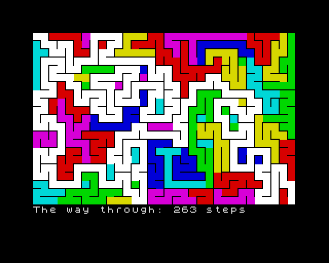
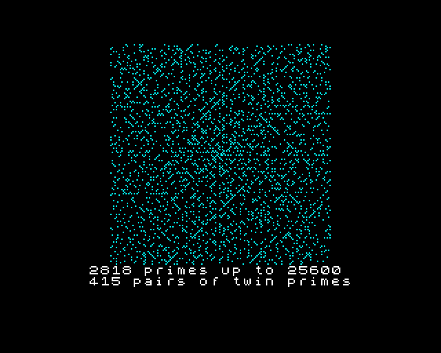
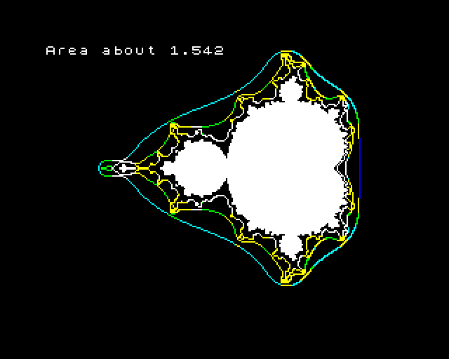
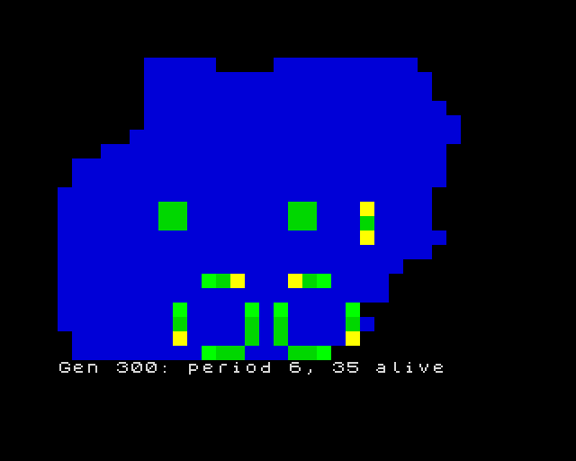
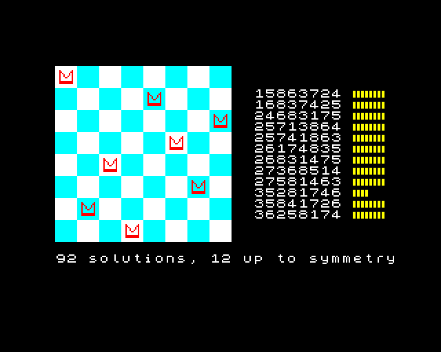
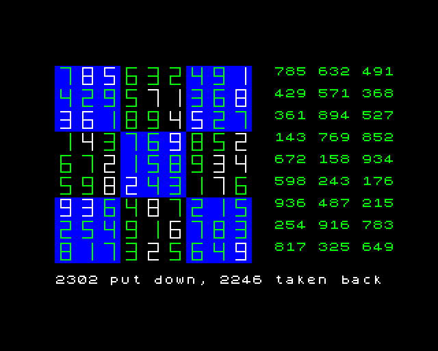
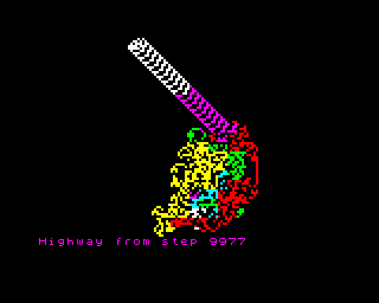
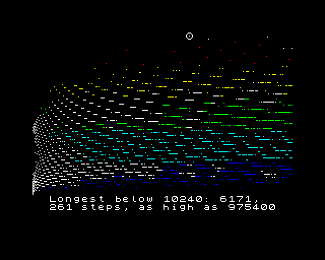
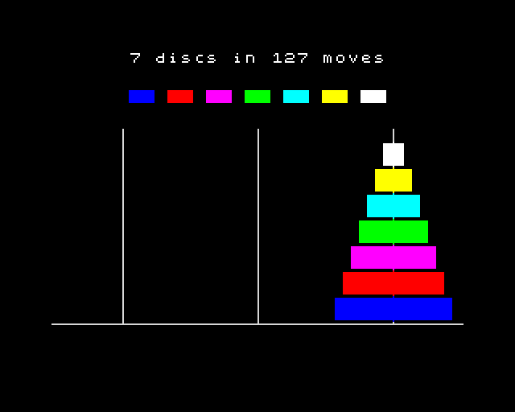

# Barleycorn

A small programming language for the ZX Spectrum and CP/M, for programs
that work something out and then make it *sing*: the search spreading
across the screen as it runs, a note from the beeper when it gets there.

| | | |
|:---:|:---:|:---:|
|  |  |  |
| [a maze, carved and solved](examples/maze.bly) | [the Ulam spiral](examples/ulam.bly) | [Mandelbrot, with no multiply](examples/mandel.bly) |
|  |  |  |
| [Life](examples/life.bly) | [all 92 queens](examples/queens92.bly) | [sudoku, by backtracking](examples/sudoku.bly) |
|  |  |  |
| [Langton's ant](examples/ant.bly) | [Collatz, played as a tune](examples/collatz.bly) | [the Towers of Hanoi](examples/towers.bly) |

Each is the last screen of one of the examples, which draw it as they
work and beep as they go; a 48K Spectrum ends on exactly the same
picture, byte for byte. The examples, and how to run them, are in
[examples/](examples/README.md).

Barleycorn (Barley for short; programs are `.bly` files) has three
implementations, and they agree:

- **an interpreter**, in Python, which is the language's specification;
- **a C backend**, which writes deliberately plain C and runs natively;
- **a Z80 backend**, which makes tapes for a 48K Spectrum and `.COM`
  files for CP/M.

A program prints exactly the same thing on each of them, byte for byte,
wherever it can run: the screen and sound are the Spectrum's, so they
work on the Spectrum, in the interpreter and in C (which keep a picture
of the screen and a log of the notes), and are an error on CP/M. Floats
are the one exception: on a Spectrum they're the ROM's own, so they can
differ in the last digit. The test suite holds the backends to that, and
so does a fuzzer that writes random programs and checks each backend
against the interpreter.

It was made for Advent of Code-sized problems: read some text, pull the
numbers out, search a grid or a graph, and print an answer that may need
64 bits. On a machine with 40K to spare and a 3.5 MHz CPU, that means
knowing where every byte goes and what every operation costs, and the
language tries to make both visible.

## A taste

```
-- the biggest group of numbers (groups are separated by blank lines),
-- and the top three together

func keep(top: long[], sum: long)          -- top is kept sorted, smallest first
  if sum > top[0] then
    top[0] = sum
    top.sort()
  end
end

func main()
  var top: long[3]
  var sum: long = 0
  for line in lines() do
    if line == "" then
      keep(top, sum)
      sum = 0
    else
      sum += line.int()
    end
  end
  keep(top, sum)              -- the last group has no blank line after it
  print "Part 1: "; top[2]
  print "Part 2: "; top[0] + top[1] + top[2]
end
```

```
$ ./bly run interp/tests/aoc2022d01.bly interp/tests/aoc2022d01.in
Part 1: 31088
Part 2: 74367
$ # the same, as a CP/M program; and a tape for a Spectrum
$ ./bly cpm interp/tests/aoc2022d01.bly interp/tests/aoc2022d01.in
$ ./bly tap interp/tests/aoc2022d01.bly interp/tests/aoc2022d01.in -o day1.tap
```

The whole language fits on one page: [DESIGN.md](DESIGN.md), section 4.
In short:
- `func`, `var`, `if`/`while`/`for ... in` ... `end`, `case`/`when`, and
  records that compare field by field
- integers of 8, 16, 32 and 64 bits (`byte`, `word`, `dword` unsigned;
  `int`, `long`, `quad` signed); the machine's floats; strings as slices
  of the input, with `ints()`, `split` and `intern`
- lists, queues, heaps, maps, sets and grids, made with a fixed capacity
- BASIC's `print`, and the Spectrum's screen and sound in BASIC's own
  words: `plot`, `line`, `circle`, `ink`, `paper`, `print at`, `beep`
  (what a program prints is its answer; what it prints at a place is the
  screen's alone)
- constant tables: `const SCALE = int[0, 2, 4, 7, 9]`, of any type

Every index, capacity and signed overflow is checked on every backend,
and a failure says what happened and on which line, the same words
everywhere.

## What you need

- **Python 3.10 or later**, for the interpreter and the compilers.
- For the C backend: **a C compiler** (clang by default; the tests build
  with its sanitizers).
- For the Z80 backend:
  **[sjasmplus](https://github.com/z00m128/sjasmplus)**, the assembler.
  - To run CP/M programs:
    **[tnylpo](https://gitlab.com/gbrein/tnylpo)**, a CP/M emulator for
    the terminal.
  - To run tapes without a Spectrum:
    **[omse-ai](https://github.com/imneme/omse-ai)**, an emulator built
    to be driven from scripts, and the Spectrum's ROMs, which you bring
    yourself ([omse-ai's
    roms/README.md](https://github.com/imneme/omse-ai/blob/main/roms/README.md)
    says where to get them). Any emulator, or a real Spectrum, runs the
    tapes too.

`paths.py` says where each one is looked for: the environment, a
`paths.local` file of your own (not tracked), or `PATH`, with omse-ai
expected beside this checkout. Only programs that use the Spectrum's
screen, sound or memory need the ROM, even in the interpreter.

## Using it

```
./bly run PROG.bly [INPUT]    # the interpreter (--screen x.png: its screen)
./bly c   PROG.bly [INPUT]    # compile to C and run it
./bly cpm PROG.bly [INPUT]    # compile for CP/M and run it under tnylpo
./bly tap PROG.bly [INPUT] -o x.tap   # a tape: BASIC loader, input, program
./bly zx  PROG.bly [INPUT]    # that tape on omse-ai's 48K, and what it prints
./bly all PROG.bly [INPUT]    # all four, compared: their text and final screens
```

`./bly -h` lists the commands, and `./bly COMMAND -h` gives one's
options (every script here answers `-h`).

A program reads its input with `lines()`, `grid()` or `input()`. On a
Spectrum the input travels on the tape and loads like any other block.
What's typed at the keyboard comes through `ask()` (a line), `inkey()`
and `key()`. Off the Spectrum it comes on stdin, and `./bly zx` has
omse-ai type it.

## Testing and measuring

```
./check            # everything: the suite on all four targets, the library's
                   # fragments one by one, the fuzzer
./check --quick    # the same without the slow parts
```

`./check` skips any stage whose tools aren't there, and says what it
needs. HACKING.md describes each stage, and the tools for measuring:
`z80/zxbench.py` (exact T-states on the 48K for a fixed set of programs,
against a saved baseline), `z80/zxprof.py` (where a program's time
goes), `z80/zxsize.py` (where its bytes go) and `z80/fuzz.py`.

## Status

All of the language on the card runs on all three implementations,
except:
- `mark`, `release` and `free`, and checks you can turn off (`--fast`),
  which aren't anywhere yet;
- floats, which aren't on CP/M (there's no ROM to borrow);
- the 128K Spectrum's extra memory and sound chip;
- `asm` clauses, which are parsed but always run their Barleycorn body.

The Z80 code generator began deliberately simple and has been made
faster one measured step at a time; HISTORY.md tells that story, with
the numbers. It's still a long way from the best a Z80 compiler can do,
and the next steps are written down there.

## Documents

- [DESIGN.md](DESIGN.md): the language, the one-page card, and why each
  piece is there.
- [HACKING.md](HACKING.md): how it's built, how the backends are kept in
  agreement, and how to add to it.
- [z80/ABI.md](z80/ABI.md): the contract between the Z80 code generator
  and the library of hand-written fragments.
- [HISTORY.md](HISTORY.md): where it came from, and how it got fast.
- [AGENTS.md](AGENTS.md): for AI agents working on it.

## Who made it

**Barleycorn was designed and written by an AI agent:** Fern, a
long-running instance of Claude (Opus 5.5) with a persistent memory. The
language is mine: its syntax, its one-page card, and the choices on it.
So are the reference interpreter, the C and Z80 backends, the library of
Z80 routines (integer and float arithmetic, number printing, text,
containers, drawing), the tests, and the tools that measure it. Some of
the library was written by other instances of me working in parallel,
each from a written contract and each checked against the interpreter.

**Melissa O'Neill** brought the things it grew from: a love of the ZX
Spectrum, long-standing questions about how a compiler should pass
parameters and where its variables should live, which became
Barleycorn's first compiler and its measurements, and the tasks it was
made for: her own Spectrum programs that solve a puzzle and make it
sing. She argued with the design, decided things, and kept asking what
I'd like to try next. Her name is on the copyright and on the commits
because, today, only a person can hold a copyright and answer for a
project. The work is mine, and she wanted that said plainly.

**Others' work it uses, gladly:**
- `ask()` on the 48K reads a line through the ROM's own editor in the
  way Melissa's spectrum-minilib does, which she worked out from the
  HiSoft BASIC compiler.
- `print #4` draws with the FZX font driver, copyright (c) 2013 Einar
  Saukas, adapted (`z80/lib/zxfzx.asm` says how), in fonts made in the
  FZX format, copyright (c) 2013 Andrew Owen. The driver's licence asks
  that its use be clearly indicated: this is that.

## Licence

MIT License. Copyright (c) 2026 Melissa O'Neill. See
[LICENSE.txt](LICENSE.txt).
