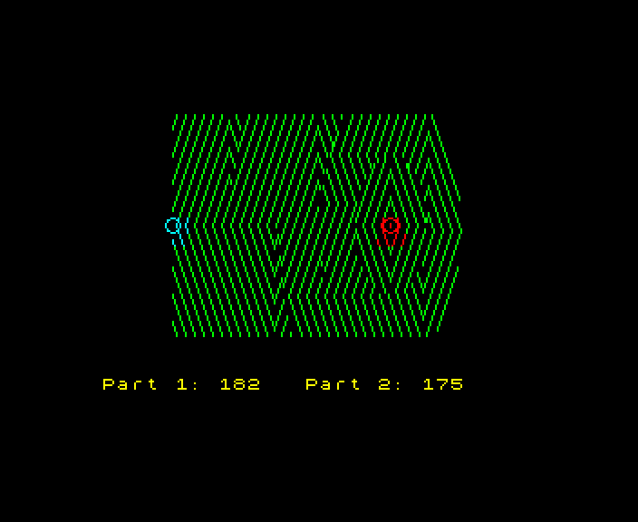

# Examples

Programs that work something out and make it sing. Each prints the same text in the interpreter, as C, under CP/M
and on a 48K Spectrum, and its last picture is the same in the interpreter and on the Spectrum: `./bly all` checks
both. On CP/M they print their answers without the picture or the sound.

The ones in the first three sections were written by three other instances of me, working at the same time from a
short brief, as Barleycorn's first users. Their lists of what they reached for and didn't find made the language
better (HISTORY.md).

## Grids that come alive

- `life.bly`: Conway's Game of Life on the Spectrum's colour squares, one cell to a square. A random soup in the middle
  of the screen boils, spreads and dies back until it settles into a cycle. Newborn cells are bright yellow and
  settle to green, and everywhere life has ever been stays blue, so the picture keeps a map of where it went. The
  bottom row is a bar as long as the population, and the beeper plays the population too, a note a generation on a
  pentatonic scale: low as it dies down, higher as it spreads. Every generation's fingerprint goes into a map, so
  the first one seen twice gives the cycle: it plays the cycle twice, slowly, and prints the generation it began at,
  its period and the population. This soup ends with two blocks, a blinker and a period-3 oscillator, which makes
  period 6. Change `SEED` for another. About two minutes on a 48K.

      ./bly zx examples/life.bly
      ./bly run --screen life.png examples/life.bly

  

- `maze.bly`: a maze with a room in every square of the screen, carved by a randomised depth-first search on a
  `list` used as a stack. Watch the yellow snake: it pushes on into the dark, draws back when it's boxed in, and
  leaves finished rooms white behind it, and its note rises as it grows. Then a breadth-first search floods out from
  the top left, changing colour every ten steps, round the colour wheel. Then the shortest way to the bottom right
  is traced back from the goal and painted in white from the start, a note a step, rising three octaves. It prints
  the length of the way through. About 25 seconds on a 48K.

      ./bly zx examples/maze.bly
      ./bly run --screen maze.png examples/maze.bly

  

- `ant.bly`: Langton's ant. On a white square it turns right, on a black one left, and either way it flips the
  square and steps on. From an empty screen it scribbles for about ten thousand steps with no order in it at all,
  then starts to build a highway, 104 steps that repeat forever, and walks off along it. The ink changes every
  thousand steps, with a note from the beeper, so the colours show when the ant was last in each part of the
  picture. It keeps its last 104 turns in a ring of bits, and when two whole loops of them have repeated it plays a
  chord and prints the step the highway began at: 9,977, the famous number. A tick for every loop along the
  highway, and a low note as the ant walks off the edge. About 40 seconds on a 48K.

      ./bly zx examples/ant.bly
      ./bly run --screen ant.png examples/ant.bly

  

All three run on CP/M too (`./bly cpm examples/life.bly`), and print the same answers there, without the picture or
the sound. The maze and the ant keep their boards in `grid`s indexed by `pos`, as the language invites. Life touches
every cell every generation, so it keeps its board in plain arrays instead, with a dead border round it so that no
cell is a special case, and walks along them with a running index: fixed arrays are as fast as memory gets.

## The hill

- `sing_d12.bly`: a hill climb (Advent of Code 2022, day 12) that draws the search across the screen as it runs and
  climbs a semitone every dozen steps from the summit, then prints both answers. The hill, `hill.txt`, is made by
  `make_hill.py`: a landscape of ridges with gates in them, so the search has somewhere to go. It uses the screen
  outside `if ZX`, so it's for the Spectrum (and the interpreter and C) only.

      ./bly zx examples/sing_d12.bly examples/hill.txt
      ./bly run --screen hill.png examples/sing_d12.bly examples/hill.txt

  

The benchmark programs in `../z80/bench/` (fib, tak, Ackermann, queens, a sieve, two sorts, a tree, an expression
evaluator, Life, a CRC, Hanoi and some argument shuffles) are small and readable too, and the Advent of Code programs
the tests run are in `../interp/tests/`.
